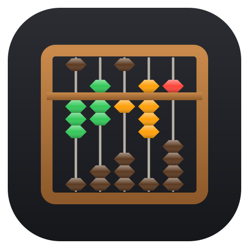
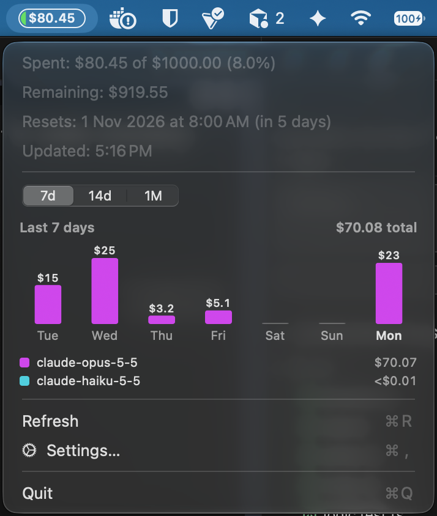
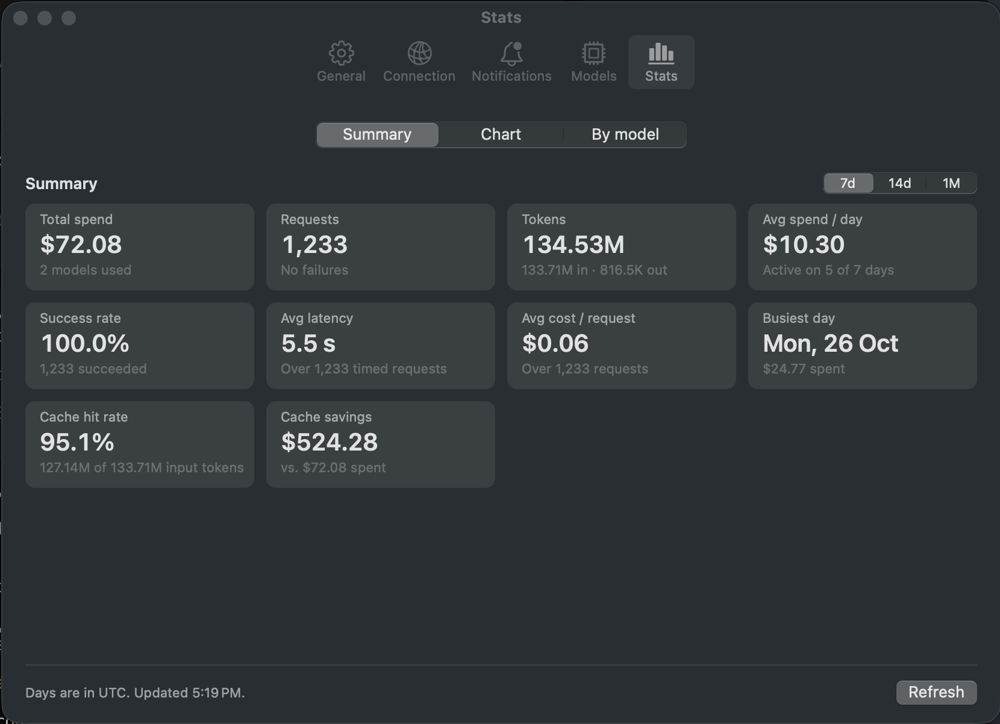

<p align="center"></p>

# Soroban

[](https://github.com/flikkr/soroban/releases/latest)

A small macOS menu bar app that shows how much of your [LiteLLM](https://docs.litellm.ai/) budget you've spent.

*Soroban* (算盤) is the Japanese word for abacus, a fitting name for a little tool that keeps count of your spending.

- **Menu bar pill** that fills up as you spend, with the amount inside. Green under 50% of your budget, orange from 50%, red from 90%.
- **Menu** with spent / remaining, when the budget resets, and when it last updated.
- **Spend chart** for the last 7 days, 14 days or month, split by model. Hover a bar or a model in the key to highlight it.
- **Budget alerts**: a notification when you pass 50%, 80%, 90% or 100% of your budget (you choose which).
- **Settings**: launch at login, refresh interval, connection, alerts, a list of available models with prices, and usage stats.

<p align="center">
  
  &nbsp;
  
</p>

Requires macOS 13 or later, and a [LiteLLM proxy](https://docs.litellm.ai/docs/simple_proxy) server with a virtual API key.

## Install

```sh
curl -fsSL https://raw.githubusercontent.com/flikkr/soroban/main/install.sh | sh
```

This downloads the latest release, installs it to `~/Applications/Soroban.app` and opens it. Run it again to update.

### Build from source

You need the Xcode command line tools (`xcode-select --install`).

```sh
./build.sh --install
open ~/Applications/Soroban.app
```

`./build.sh` on its own builds `build/Soroban.app` without installing it.

To start it automatically, open **Settings… → General** from the menu and tick **Launch Soroban at login**. Do this from the installed copy in `~/Applications`, so macOS remembers that location.

## Setup

The app reads these environment variables, the same ones you'd use for LiteLLM in your shell:

| Variable | Example |
|---|---|
| `LITELLM_API_KEY` | `sk-…` |
| `LITELLM_API_URL` | `https://litellm.example.com` (the server root; a trailing `/v1` is ignored) |

Apps opened from Finder or at login don't see variables set in `~/.zshrc`, so if they're missing, the app asks your login shell for them.

You can also set the server URL and API key in **Settings → Connection**. These take priority over the environment. The API key is stored in your macOS Keychain. Use **Test Connection** to check it works.

## Settings

| Tab | What's there |
|---|---|
| **General** | Launch at login, refresh interval (1/5/15/30 min), refresh when the menu opens, app version |
| **Connection** | Server URL and API key overrides, Test Connection |
| **Notifications** | Which budget thresholds to alert on, and a test notification |
| **Models** | Every model your key can use: price per 1M input/output tokens, context size, max output, and features |
| **Stats** | Usage for the last 7 days, 14 days or month: total spend, requests, tokens, average spend per day, success rate, average latency, cost per request, busiest day, and a per-model breakdown |

Budget alerts are sent once per budget period, the first time you pass each threshold, and start again after the budget resets.

## Versioning

The version number lives in [`VERSION`](VERSION). `build.sh` writes it into the app, along with a build number (the git commit count). It's shown in **Settings → General**.

To release a new version:

1. Bump `VERSION` (e.g. `1.0.0` → `1.1.0`) and commit it.
2. Tag the commit with the same version and push the tag:
   ```sh
   git tag v1.1.0
   git push origin v1.1.0
   ```

The **Release** GitHub Actions workflow builds the app and publishes a GitHub release with `Soroban-v1.1.0.zip` attached. It fails if the tag doesn't match `VERSION`.

The **Build** workflow builds the app on every push to `main` and every pull request, and uploads the zipped app as a workflow artifact.

## Troubleshooting

- **`LLM ⚠︎` in the menu bar**: open the menu to see the error. Usually the server can't be reached (e.g. it's on a private network you're not connected to), or the API key is wrong. Check it in **Settings → Connection → Test Connection**.
- **No notifications**: check **System Settings → Notifications → Soroban**, then use **Send Test Notification**.
- **Launch at login doesn't stick**: make sure you turned it on from `~/Applications/Soroban.app`, and allow it under **System Settings → General → Login Items** if asked.
